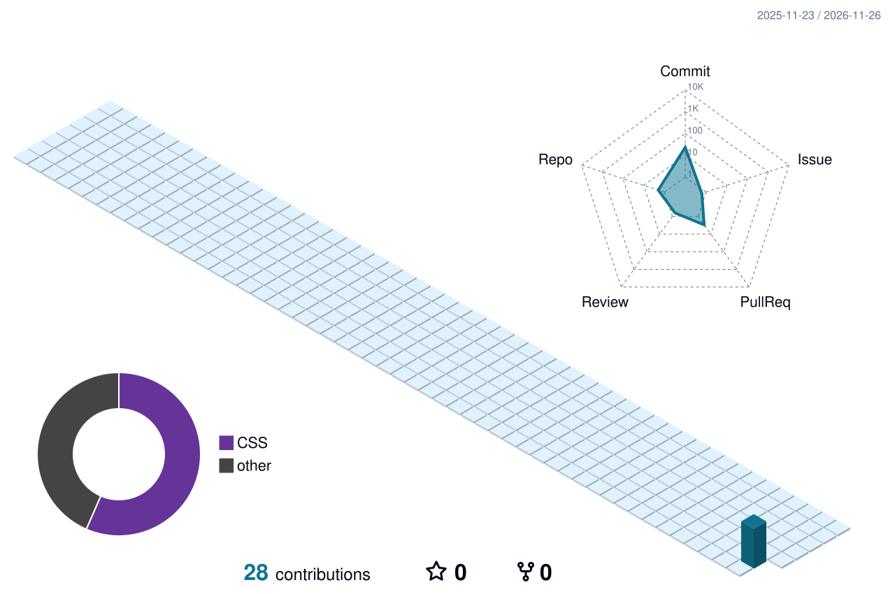

Web 安全 · 漏洞研究 · 工具与自动化

<picture>
  <source media="(prefers-color-scheme: dark)" srcset="assets/terminal-dark.svg" />
  <source media="(prefers-color-scheme: light)" srcset="assets/terminal-light.svg" />
  
</picture>

## 关于我

<picture>
  <source media="(prefers-color-scheme: dark)" srcset="assets/about-dark.svg" />
  <source media="(prefers-color-scheme: light)" srcset="assets/about-light.svg" />
  
</picture>

## 技术栈

 

## GitHub 统计

<picture>
  <source media="(prefers-color-scheme: dark)" srcset="https://github-readme-stats.vercel.app/api?username=0xSY-SEC&show_icons=true&hide_border=true&theme=tokyonight&bg_color=0d1117&title_color=38bdf8&icon_color=22d3ee&text_color=c9d1d9&locale=cn" />
  <source media="(prefers-color-scheme: light)" srcset="https://github-readme-stats.vercel.app/api?username=0xSY-SEC&show_icons=true&hide_border=true&theme=default&bg_color=ffffff&title_color=0e7490&icon_color=0369a1&text_color=24292f&locale=cn" />
  
</picture>

<picture>
  <source media="(prefers-color-scheme: dark)" srcset="https://streak-stats.demolab.com?user=0xSY-SEC&hide_border=true&theme=tokyonight&background=0D1117&ring=38BDF8&fire=38BDF8&currStreakLabel=38BDF8&locale=zh_Hans" />
  <source media="(prefers-color-scheme: light)" srcset="https://streak-stats.demolab.com?user=0xSY-SEC&hide_border=true&theme=default&background=FFFFFF&ring=0E7490&fire=0369A1&currStreakLabel=0E7490&locale=zh_Hans" />
  
</picture>

<picture>
  <source media="(prefers-color-scheme: dark)" srcset="https://github-readme-stats.vercel.app/api/top-langs/?username=0xSY-SEC&layout=compact&hide_border=true&langs_count=8&theme=tokyonight&bg_color=0d1117&title_color=38bdf8&text_color=c9d1d9&locale=cn" />
  <source media="(prefers-color-scheme: light)" srcset="https://github-readme-stats.vercel.app/api/top-langs/?username=0xSY-SEC&layout=compact&hide_border=true&langs_count=8&theme=default&bg_color=ffffff&title_color=0e7490&text_color=24292f&locale=cn" />
  
</picture>

## 成就

<picture>
  <source media="(prefers-color-scheme: dark)" srcset="https://github-profile-trophy-nu.vercel.app/?username=0xSY-SEC&theme=nord&no-frame=true&no-bg=true&row=1&column=8&margin-w=6" />
  <source media="(prefers-color-scheme: light)" srcset="https://github-profile-trophy-nu.vercel.app/?username=0xSY-SEC&theme=flat&no-frame=true&no-bg=true&row=1&column=8&margin-w=6" />
  
</picture>

## 贡献

<picture>
  <source media="(prefers-color-scheme: dark)" srcset="https://raw.githubusercontent.com/0xSY-SEC/0xSY-SEC/output/profile-3d-contrib/profile-cyan-dark.svg" />
  <source media="(prefers-color-scheme: light)" srcset="https://raw.githubusercontent.com/0xSY-SEC/0xSY-SEC/output/profile-3d-contrib/profile-cyan-light.svg" />
  
</picture>

<picture>
  <source media="(prefers-color-scheme: dark)" srcset="https://raw.githubusercontent.com/0xSY-SEC/0xSY-SEC/output/github-contribution-grid-snake-dark.svg" />
  <source media="(prefers-color-scheme: light)" srcset="https://raw.githubusercontent.com/0xSY-SEC/0xSY-SEC/output/github-contribution-grid-snake.svg" />
  
</picture>

## 最新文章

来自 [博客](https://0xsy-sec.github.io/)（Hugo Blowfish）。

<!-- BLOG-POST-LIST:START -->
- [站点已就绪](https://0xsy-sec.github.io/posts/notes/welcome/)
<!-- BLOG-POST-LIST:END -->

 

公众号「0xSY」

  

